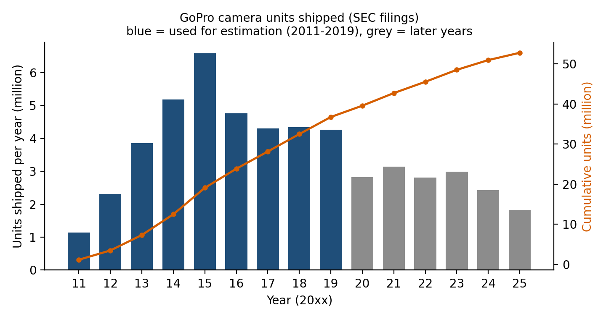
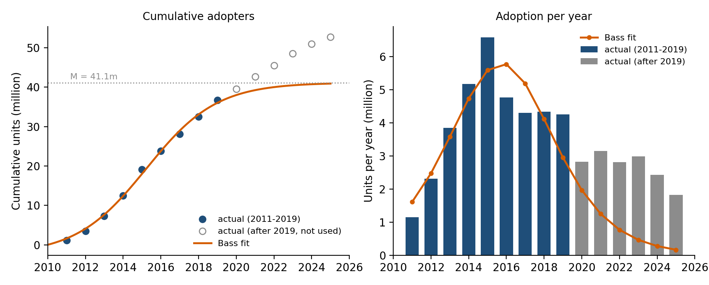
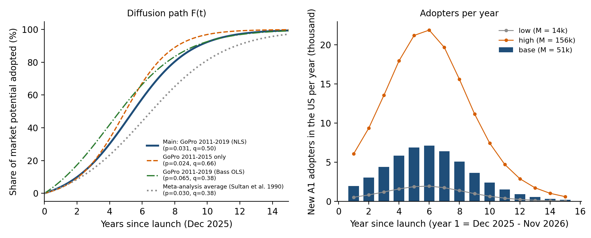
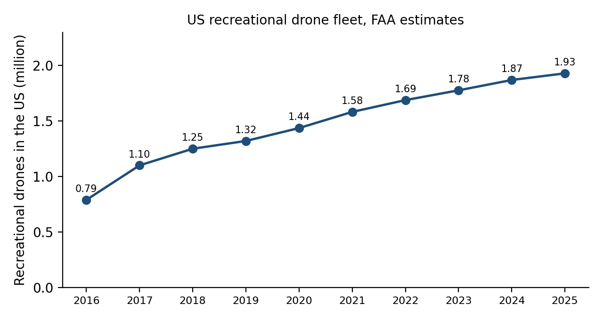

# Homework on Bass Model: Innovation Diffusion Analysis

**Innovation: Antigravity A1 (TIME Best Inventions 2025)**

Stepan Titanyan | Marketing | Instructor: Karen Hovhannisyan | October 2026

---

## 1. Chosen innovation

I chose the **Antigravity A1**, a drone from TIME's list *The Best Inventions of 2025*.

Link: <https://time.com/collections/best-inventions-2025/7318266/antigravity-a1/>

The A1 is a small drone built around a 360° camera. TIME says Antigravity is the first company to design a drone around a 360° camera from the start, so pilots get a drone's-eye view in any direction they like. It comes with head-tracking goggles and a controller that is used with one hand, and it weighs 249 g, so buyers in the US and most other markets do not need a licensed operator (Wilson, 2025). The goggles show one direction at a time, but the recorded video can be viewed from any angle afterwards (Wikipedia, "Antigravity A1"). It went on sale on 4 December 2025, about two months earlier than planned, at a starting price of $1,599 for a bundle with the drone, goggles and controller (DroneXL, 2025). It records 8K 360° video and flies about 24 minutes on the standard battery (DroneXL, 2025). Antigravity is a separate drone brand that was incubated by Insta360, the 360° camera company, and the A1 camera is based on Insta360's X series (Wikipedia, "Antigravity A1").

## 2. A similar innovation from the past: the GoPro HERO

My look-alike is the **GoPro HERO action camera**, the first HD model of which came out in July 2009. In functionality both products do the same job: they let a person record an activity from a point of view that a normal camera cannot reach, and then share it. The GoPro was strapped to a helmet or a surfboard, the A1 flies, but the user in both cases is a creator who wants a new kind of footage, usually for social media. In technology both rely on small wide-angle sensors, electronic stabilization and a phone app. The A1 adds a second lens for full 360° capture and head-tracking goggles, and it comes from a brand incubated by Insta360, a company that also makes 360° and action cameras, so the A1 is more or less an action camera that flies. In market impact, GoPro created a new product category, doubled its units in 2012 (+102%) and grew them by another 66% in 2013, and by 2014 it was sold in over 100 countries through more than 25,000 stores (GoPro, 2014). The A1 is trying to do the same for "360° drones", where the established maker of consumer drones is DJI. I think the main difference is the price. GoPro's average selling price was $280 in 2019 (GoPro, 2020), while the cheapest A1 bundle is $1,599, about 5.7 times higher, so I expect the A1 to have a much smaller market potential M, and I treat M separately from p and q below.

I also thought about the DJI Phantom (January 2013), an affordable ready-to-fly drone that could carry a GoPro camera (Wikipedia, "DJI Phantom"), because the A1 is also a drone. I went with GoPro because of the data, which I explain in the next section.

## 3. Historical data

**Series.** Annual camera units shipped by GoPro, taken from the company's own filings with the US SEC (S-1 of 2014 and the 10-K reports for 2014 to 2025). The numbers and the filing each one comes from are in `data/gopro_units_shipped.csv`. GoPro defines units shipped as individual packaged camera units shipped in the period, net of returns.

| Year | Units shipped (million) | Cumulative (million) |
|---|---|---|
| 2011 | 1.145 | 1.145 |
| 2012 | 2.316 | 3.461 |
| 2013 | 3.849 | 7.310 |
| 2014 | 5.180 | 12.490 |
| 2015 | 6.584 | 19.074 |
| 2016 | 4.762 | 23.836 |
| 2017 | 4.303 | 28.139 |
| 2018 | 4.337 | 32.476 |
| 2019 | 4.260 | 36.736 |
| 2020 | 2.820 | 39.556 |
| 2021 | 3.145 | 42.701 |
| 2022 | 2.810 | 45.511 |
| 2023 | 2.984 | 48.495 |
| 2024 | 2.431 | 50.926 |
| 2025 | 1.826 | 52.752 |

*Sources: GoPro S-1 (2014) for 2011; GoPro 10-K reports for fiscal years 2014, 2016, 2019, 2020, 2022, 2024 and 2025 for the other years.*



**Choices I made.**

- *Why not Statista.* The assignment suggests Statista. The Statista page for worldwide consumer drone shipments only starts in 2020 and the numbers are hidden behind the Premium wall (Statista, 2021), so I could not use it for a full life cycle. Company filings are the primary source for a unit series like this one, and they are official documents filed with the regulator.
- *Why not drones.* I first tried the FAA estimate of the US recreational drone fleet (2016 to 2025, see section 6 and `data/faa_recreational_drone_fleet.csv`). That series starts in 2016, when the market was already past the take-off, so the data cannot separate p and q. At the end of `01_bass_estimation.py` I fixed q at different values and the fit hardly changed: among the values I tried, the best q is 0.06 if I assume the market started in 2012 and 0.2 if I assume 2010 or 2008. The GoPro series covers the whole rise, so I used it for p and q and kept the FAA data for the market size.
- *Estimation window.* I use 2011 to 2019. 2011 is the first year GoPro reported units. I stop in 2019 because of COVID and because after 2019 GoPro keeps selling roughly 2 to 3 million cameras a year until 2024 without the sales dying out. This probably comes from replacement purchases, and the basic Bass model does not describe that. I show other windows in section 4.
- *Missing sales before 2011.* Period 1 is 2011 and cumulative sales start at zero. GoPro's revenue in 2010 was $64 million against $234 million in 2011 (GoPro, 2014), so earlier sales were small. I test the effect in the robustness table.

## 4. Bass model parameters

The Bass (1969) model says that the chance of adopting in the next moment, among people who have not adopted yet, is p + q × (share who already adopted). Here p is the coefficient of innovation (adoption that does not depend on others), q is the coefficient of imitation (word of mouth and social influence) and M is the market potential (total number of eventual adopters). With continuous time the cumulative adopters are

```
N(t) = M * F(t),   F(t) = (1 - exp(-(p+q)t)) / (1 + (q/p) * exp(-(p+q)t))
```

and the adoption rate peaks at t* = ln(q/p) / (p+q) when q > p.

**Method.** My main estimate is non-linear least squares on the cumulative units, 2011 to 2019 (9 observations, t = 1 for 2011), with the optimiser started from many different values (Srinivasan and Mason, 1986). For comparison I did two more: non-linear least squares on the yearly units, and the original regression of Bass (1969), S(t) = a + b N(t-1) + c N(t-1)², which gives M = (-b - sqrt(b² - 4ac)) / 2c, p = a / M and q = -M c. The code is in `helper_functions.py` and `01_bass_estimation.py`.

| Method (2011 to 2019) | p | q | M (million) | q / p | R² |
|---|---|---|---|---|---|
| **NLS on cumulative units (main)** | **0.0308** (s.e. 0.0037) | **0.504** (s.e. 0.057) | **41.1** (s.e. 2.1) | 16.4 | 0.997 (cumulative), 0.745 (yearly units) |
| NLS on yearly units | 0.0347 (s.e. 0.0086) | 0.447 (s.e. 0.089) | 43.7 (s.e. 4.7) | 12.9 | 0.763 (yearly units) |
| Bass (1969) regression | 0.0647 | 0.383 | 42.4 | 5.9 | 0.555 (regression on yearly units) |

*The standard errors are approximate because there are only nine data points. The R² of the cumulative fit is very high for any smooth S-curve, so the yearly R² is more informative.*



**Interpretation.** In the main fit about 3% of the remaining potential adopters buy each year without any influence from others (p = 0.031), and the imitation effect is 16 times stronger than the innovation effect (q / p = 16.4), which gives a clear S-curve. The model puts the peak of adoption at t* = 5.2 years, which is early 2016 and about 5.8 million units a year, while the real peak was 2015 with 6.6 million. The market potential is 41 million cameras. For comparison, the meta-analysis of Sultan, Farley and Lehmann (1990) reports average values of p = 0.03 and q = 0.38 over many published applications, so my p is almost the same and my q is somewhat higher, which makes sense for a product that spreads through shared videos. The three methods agree on the basic picture (p between 0.03 and 0.06, q between 0.38 and 0.50, M between 41 and 44 million).

**Robustness.**

| Specification | Obs. | p | q | M (million) |
|---|---|---|---|---|
| 2011 to 2015 (until the peak) | 5 | 0.0239 | 0.657 | 37.7 |
| 2011 to 2016 | 6 | 0.0256 | 0.751 | 30.8 |
| **2011 to 2019 (main)** | 9 | 0.0308 | 0.504 | 41.1 |
| 2011 to 2025 (all years) | 15 | 0.0383 | 0.275 | 55.6 |
| t = 0 in July 2009, plus 0.34 m units before 2011, 2011 to 2015 | 5 | 0.0070 | 0.774 | 32.9 |
| t = 0 in July 2009, plus 0.34 m units before 2011, 2011 to 2019 | 9 | 0.0107 | 0.583 | 40.1 |

For the last two rows I set t = 0 at the launch of the first HD GoPro in July 2009 and added 0.34 million units sold before 2011. That number comes from the S-1, which says GoPro had sold more than 8.5 million HD cameras since July 2009. If that count runs until the end of March 2014, then subtracting the 7.3 million of 2011 to 2013 and 0.85 million of the first quarter of 2014 leaves 0.34 million (GoPro, 2014). A second check gives a similar number: 2010 revenue of $64 million divided by the 2011 revenue per unit of about $205 ($234 million / 1.145 million units) is 0.31 million units. So it is only approximate. q stays between 0.5 and 0.8 whenever the window ends in 2019 or earlier, and M between 31 and 41 million. p is the weakest parameter: it moves from 0.007 to 0.03 depending on when I start the clock, which is normal because p is determined by the very first years. When I use all years up to 2025, q falls to 0.28 and M rises, because the later sales do not decline as the model expects.

**Hold-out test.** I fitted only 2011 to 2015 and predicted the cumulative units for 2016 to 2019. The predictions were 25.4, 30.3, 33.6 and 35.5 million against actual values of 23.8, 28.1, 32.5 and 36.7 million, so the error was between -3.4% and +7.7% (printed by `01_bass_estimation.py`). The model is less good for single years: it predicted 6.3 million for 2016 while GoPro sold 4.8 million. GoPro's 10-K for 2016 says the 28% drop that year came from channel inventory being reduced (sell-through above sell-in) before the launch of HERO5 (GoPro, 2017), so this is not a pure demand effect.

## 5. Predicted diffusion path of the Antigravity A1

**Approach.** The look-alike gives me the shape of diffusion: how fast a new camera-based creator product starts (p) and how strongly it spreads through imitation (q). I apply p = 0.0308 and q = 0.504 to the A1 with t = 0 on the launch date, 4 December 2025. The market potential M belongs to the A1 itself, so it is estimated in section 7 after the scope is chosen in section 6. In terms of the share of M, the main result is:

| Time since launch | Share of M adopted |
|---|---|
| 1 year (Dec 2026) | 3.9% |
| 3 years (Dec 2028) | 18.6% |
| 5 years (Dec 2030) | 43.7% |
| 10 years (Dec 2035) | 92.3% |

The adoption rate is highest at 5.2 years after launch (February 2031), where about 14.2% of M adopts per year. Half of M has adopted after 5.5 years and 90% after 9.5 years. The path is slow at first because only the innovators buy and it speeds up as the number of owners grows.



**Data supporting this prediction.**

- The Bass model fits the look-alike well and predicted its cumulative sales to within 8% in the hold-out test (section 4). My p and q are also close to the average values in the literature (Sultan et al., 1990). When I replace them with those averages (p = 0.03, q = 0.38), the share of M after 5 years falls from 43.7% to 33.1% and the peak moves to 6.2 years (printed by `02_a1_forecast.py`). With the p and q of the Bass regression (0.065 and 0.38) the A1 would be faster at the start (7.5% after one year). The ranking of the curves is in the left panel of the figure above.
- Signs that support adoption: the A1 was launched about two months early (DroneXL, 2025) and was sold at Best Buy and other stores from the first day. By January 2026 Antigravity added more retail stores and Amazon and ran a 15% discount until 9 February 2026 (No Film School, 2026). In December 2025 the FCC put foreign-made drones on its Covered List, so they cannot get new equipment authorizations. The A1 got its FCC approval just before the rule took effect, while the FCC has not approved new DJI products since November 2025, so DJI's latest products have not been released in the US (Rest of World, 2026; DRONELIFE, 2026).
- Signs that slow it down: the price is high compared with the market. The FAA gives an average price of "$750 or less" for recreational drones (FAA, 2025), and one review title says that only a "sky-high price tag" holds the A1 back (TechRadar, n.d.). The A1 needs a visual observer in the US because the pilot wears goggles, and it cannot carry more than 50 g of extra weight (Wikipedia, "Antigravity A1"; Rest of World, 2026). A new version of the hardware could also need a new FCC authorization, which would be a problem under the new rule (DRONELIFE, 2026).
- No sales figures for the A1 have been published (Rest of World, 2026), so I cannot compare the prediction with actual data yet. Insta360 grew its revenue by 74.8% in 2025 but its net profit fell by 6.6% (Caixin, 2026). In the first half of 2026 its revenue grew 50.29% to 5.517 billion yuan while net profit fell 94.15%, and the article says that early-stage lines such as panoramic drones were part of the losses and that R&D went mostly to new categories like panoramic drones (The New Camera, 2026). It does not name Antigravity, so I take this only as a sign that the 360° drone business is still in an investment phase and not as a sales number.

## 6. Scope: United States

**Decision.** I analyse the **United States**, not the whole world.

1. *Data.* The only open, consistent series I found on drone ownership is from the US Federal Aviation Administration (FAA). It publishes the size of the US recreational drone fleet every year in its Aerospace Forecast (figure below). World figures are either behind a paywall (Statista, 2021) or are forecasts that disagree widely: Juniper Research expected 16 million consumer drone shipments a year by 2020 (BizReport, 2015), Tractica 67.7 million a year by 2021 (FierceElectronics, 2016) and ABI Research more than 90 million a year by 2025 (ABI Research, 2016).
2. *Importance of the market.* The US is a main market for the A1. It is priced in dollars and sold through Best Buy, B&H and Amazon (DroneXL, 2025; No Film School, 2026), and Insta360's co-founder said that the US is 30% to 40% of the company's revenue (Rest of World, 2026).
3. *The rules differ by country.* In the US a drone above 250 g must be registered. The A1 is 249 g, so its buyers are not in the FAA data, and the A1 depends on the FCC situation described above. A world model would mix countries with different rules and at different stages.



The FAA fleet in the figure is cumulative registrations times aircraft per registrant (FAA, 2018 to 2026, see `data/faa_recreational_drone_fleet.csv`). It shows that the US drone market has almost saturated: 1.93 million in 2025, only 3% above 2024. New operator registrations fell from about 10,300 a month in 2021 to 4,782 a month in 2025, and the registry in 2025 had only 323,079 operators with a valid registration (296,277 with one or two aircraft and 26,802 with three or more), which is much lower than the 1.66 million who ever registered (FAA, 2022; FAA, 2026). So the A1 enters a mature market and growth has to come from owners who upgrade and from new creators outside the drone world.

**Limitation.** A US-only forecast leaves out the rest of the world. If the US share of A1 buyers is similar to the US share of Insta360's revenue (30% to 40%), the worldwide M would be roughly 145,000 in the base case (127,000 to 169,000). That is an assumption and Antigravity may differ from Insta360 as a whole.

## 7. Number of adopters by period

**Market potential M for the US (Fermi estimate).** There are no sales data for the A1, so I estimated M in steps. The two FAA numbers are data and the other three are my own assumptions (they are also in `02_a1_forecast.py`, marked as assumptions).

| Step | Low | Base | High | Source |
|---|---|---|---|---|
| US recreational drone operators (valid registration, 2025) with 3 or more aircraft | 26,802 | 26,802 | 26,802 | FAA (2026) |
| US recreational drone operators (valid registration, 2025) with 1 or 2 aircraft | 296,277 | 296,277 | 296,277 | FAA (2026) |
| Share of the 3+ aircraft owners who buy an A1 | 15% | 30% | 50% | assumption |
| Share of the 1 or 2 aircraft owners who buy an A1 | 1% | 3% | 6% | assumption |
| Buyers who are not in the FAA registry per registry buyer | 1 | 2 | 4 | assumption |
| **Buyers among registered owners** | 6,983 | 16,929 | 31,178 | calculated |
| **M = market potential, US (units)** | **13,966** | **50,787** | **155,888** | calculated |
| M times $1,599 = lifetime US revenue | $22 m | $81 m | $249 m | calculated |

The reasoning is the following. Enthusiasts (three or more aircraft) are the people most likely to pay for a premium drone, so I assume a high share of them buy. Casual owners fly about one weekend a month (FAA, 2023), so only a few buy a drone priced at about twice the average. Many A1 buyers will not be in the FAA data: the A1 is under 250 g and does not need registration, and its audience is also 360° camera users and creators, which is why I assume 2 non-registry buyers for every registry buyer in the base case. As a check, Insta360's revenue was 5.6 billion yuan ($779.9 million) in 2024 (Forbes, 2025), so with 30% to 40% in the US the company sells about $234 to $312 million a year there. My base case lifetime US revenue of $81 million for the A1 is 26% to 35% of one year of that, which seems reasonable for a niche premium product. The low case is 7% to 10% and the high case is 80% to 107%, so I see the high case as an upper limit. The base case is 2.6% of the whole US recreational drone fleet of 1.93 million.

**Predicted adopters.** With p = 0.0308 and q = 0.504 and the three values of M, adopters in a period are M times the change in F(t) over that period. The first period is only the 27 days from launch to 31 December 2025. Numbers are rounded and should be read as rough estimates.

| Period | Share of M adopted by end of period | New adopters, low | New adopters, base | New adopters, high | Cumulative, base |
|---|---|---|---|---|---|
| 2025 (from 4 Dec) | 0.2% | 32 | 118 | 361 | 118 |
| 2026 | 4.3% | 564 | 2,051 | 6,295 | 2,168 |
| 2027 | 10.5% | 864 | 3,142 | 9,644 | 5,310 |
| 2028 | 19.4% | 1,246 | 4,533 | 13,913 | 9,843 |
| 2029 | 31.1% | 1,634 | 5,943 | 18,242 | 15,786 |
| 2030 | 44.8% | 1,911 | 6,950 | 21,333 | 22,736 |
| 2031 | 58.8% | 1,953 | 7,101 | 21,797 | 29,837 |
| 2032 | 71.2% | 1,743 | 6,337 | 19,451 | 36,174 |
| 2033 | 81.0% | 1,366 | 4,969 | 15,253 | 41,143 |
| 2034 | 88.0% | 974 | 3,542 | 10,872 | 44,685 |
| 2035 | 92.6% | 647 | 2,351 | 7,217 | 47,037 |

For the first three years, by quarter (the first quarter row is the 27 days after launch):

| Quarter | Low | Base | High | Cumulative, base |
|---|---|---|---|---|
| 2025 Q4 (from 4 Dec) | 32 | 118 | 361 | 118 |
| 2026 Q1 | 116 | 423 | 1,297 | 540 |
| 2026 Q2 | 132 | 479 | 1,471 | 1,019 |
| 2026 Q3 | 149 | 543 | 1,665 | 1,562 |
| 2026 Q4 | 167 | 607 | 1,862 | 2,168 |
| 2027 Q1 | 182 | 661 | 2,027 | 2,829 |
| 2027 Q2 | 204 | 741 | 2,273 | 3,569 |
| 2027 Q3 | 228 | 828 | 2,542 | 4,398 |
| 2027 Q4 | 251 | 913 | 2,802 | 5,310 |
| 2028 Q1 | 272 | 990 | 3,039 | 6,300 |
| 2028 Q2 | 297 | 1,080 | 3,314 | 7,380 |
| 2028 Q3 | 326 | 1,185 | 3,636 | 8,564 |
| 2028 Q4 | 352 | 1,279 | 3,925 | 9,843 |

**Summary of the prediction.** In the base case about 2,200 US adopters buy the A1 by the end of 2026 and about 9,800 by the end of 2028. As of today (18 October 2026, 0.87 years after launch) the model gives about 1,700 owners in the US (460 in the low case and 5,100 in the high case). The yearly number of new adopters peaks at about 7,100 in 2031, and by 2035 about 47,000 US buyers (93% of M) have adopted. In the sensitivity analysis the base-case cumulative number of adopters after 5 years goes from 16,800 (meta-analysis p and q) to 27,800 (p and q of the Bass regression), compared with 22,200 in the main case. The uncertainty in M, which goes from 14,000 to 156,000, is much bigger than the uncertainty in p and q.

## 8. Limitations

- The Bass model counts first-time adopters only. Repeat purchases, upgrades to a new A1 model and gifts are not included. The GoPro data after 2019 show this clearly, since sales continue after the model says the market is saturated.
- p and q come from a different product (GoPro) in a different period (2011 to 2019) and for the whole world. I assumed that the speed of diffusion transfers to the A1 in the US and only rebuilt M. If the A1 benefits from Insta360's existing audience, its p is higher and the first years are underestimated.
- The estimates are based on nine annual observations and the standard errors are approximate. p depends on the starting date I choose.
- M is the weakest part. Three of the inputs are my own assumptions, and nothing in the data can check them yet. When Antigravity or Insta360 publish A1 unit sales, the first year of sales can be used to re-estimate M (and p).
- The FAA series is cumulative registrations times aircraft per registrant and the FAA now reports a different definition (active fleet) as its main number (FAA, 2026). I only use it for context and for the number of owners.

## References

ABI Research (2016). Consumer drone shipments to exceed 90 million units and generate $4.6 billion in revenue by 2025 [Press release]. <https://abiresearch.com/press/consumer-drone-shipments-exceed-90-million-units-a>

Bass, F. M. (1969). A new product growth for model consumer durables. *Management Science, 15*(5), 215-227.

BizReport (2015, November). Consumer drone shipments to hit 16 million per year by 2020. <https://www.bizreport.com/2015/11/consumer-drone-shipments-to-hit-16-million-per-year-by-2020.html>

Caixin Global (2026, April 29). Insta360 profit falls as R&D surge meets rising DJI competition. <https://www.caixinglobal.com/2026-04-29/insta360-profit-falls-as-rd-surge-meets-rising-dji-competition-102439393.html>

DRONELIFE (2026, January 5). Ambarella CV5 drone chip powers Antigravity A1 at CES (FCC Covered List). <https://dronelife.com/2026/01/05/ambarella-cv5-antigravity-a1-ces-fcc-covered-list/>

DroneXL (2025, December 4). Antigravity A1 launches: World's first 8K 360 drone starts at $1,599. <https://dronexl.co/2025/12/04/antigravity-a1-launches-8k-360-drone/>

Federal Aviation Administration. FAA Aerospace Forecast, unmanned aircraft systems chapters and compendia. The editions below were used for the fleet numbers in `data/faa_recreational_drone_fleet.csv`. In the text, "FAA (year)" means the edition published in that year, for example FAA (2022) is the FY2022-2042 edition.

- FY2017-2037 (Dec 2017 copy): <https://web.archive.org/web/20171208055353/https://www.faa.gov/data_research/aviation/aerospace_forecasts/media/Unmanned_Aircraft_Systems.pdf>
- FY2018-2038 (Dec 2018 copy): <https://web.archive.org/web/20181231215802/https://www.faa.gov/data_research/aviation/aerospace_forecasts/media/Unmanned_Aircraft_Systems.pdf>
- FY2019-2039 (Dec 2019 copy): <https://web.archive.org/web/20191215221018/https://www.faa.gov/data_research/aviation/aerospace_forecasts/media/Unmanned_Aircraft_Systems.pdf>
- FY2020-2040 (Nov 2020 copy): <https://web.archive.org/web/20201128032103/https://www.faa.gov/data_research/aviation/aerospace_forecasts/media/Unmanned_Aircraft_Systems.pdf>
- FY2021-2041 (Jan 2022 copy): <https://web.archive.org/web/20220102215648/https://www.faa.gov/data_research/aviation/aerospace_forecasts/media/Unmanned_Aircraft_Systems.pdf>
- FY2022-2042: <https://www.faa.gov/sites/faa.gov/files/2022-06/Unmanned_Aircraft_Systems.pdf>
- FY2023-2043: <https://www.faa.gov/sites/faa.gov/files/2023-Unmanned%20Aircraft%20Systems%20and%20Advance%20Air%20Mobility_0.pdf>
- FY2024-2044: <https://www.faa.gov/data_research/aviation/aerospace_forecasts/unmanned_aircraft_systems.pdf>
- Compendium FY2025-2045: <https://www.faa.gov/data_research/aviation/aerospace_forecasts/2025-uas-and-aam-full-document.pdf>
- Compendium FY2026-2046: <https://www.faa.gov/data_research/aviation/aerospace_forecasts/uas-compendium.pdf>

FierceElectronics (2016). Consumer drone sales to increase tenfold to 67.7 million units annually by 2021 [Tractica forecast]. <https://www.fierceelectronics.com/embedded/consumer-drone-sales-to-increase-tenfold-to-67-7-million-units-annually-by-2021>

Forbes (2025, June 11). Founder of Chinese camera maker Insta360 becomes a billionaire upon IPO. <https://www.forbes.com.au/?p=143660>

GoPro, Inc. (2014). Form S-1 registration statement. U.S. Securities and Exchange Commission. <https://www.sec.gov/Archives/edgar/data/1500435/000119312514204902/d552193ds1.htm>

GoPro, Inc. Annual reports on Form 10-K. U.S. Securities and Exchange Commission. In the text, GoPro (2017) is the FY2016 report and GoPro (2020) is the FY2019 report.

- FY2014: <https://www.sec.gov/Archives/edgar/data/0001500435/000150043515000007/gpro2014-12x3110xk.htm>
- FY2016: <https://www.sec.gov/Archives/edgar/data/0001500435/000150043517000013/gpro2016-12x3110xk.htm>
- FY2019: <https://www.sec.gov/Archives/edgar/data/1500435/000150043520000013/gpro2019-12x3110xk.htm>
- FY2020: <https://www.sec.gov/Archives/edgar/data/1500435/000150043521000020/gpro-20201231.htm>
- FY2022: <https://www.sec.gov/Archives/edgar/data/1500435/000150043523000021/gpro-20221231.htm>
- FY2024: <https://www.sec.gov/Archives/edgar/data/1500435/000162828025013046/gpro-20241231.htm>
- FY2025: <https://www.sec.gov/Archives/edgar/data/1500435/000150043526000006/gpro-20251231.htm>

No Film School (2026, January 27). The Antigravity A1 drone is expanding its US availability and offering a limited-time discount. <https://nofilmschool.com/antigravity-a1-update>

Rest of World (Zhou, V.) (2026, October 9). China's Insta360 targets American creators. <https://restofworld.org/2026/insta360-us-dji-sanctions-drones-cameras/>

Srinivasan, V., & Mason, C. H. (1986). Nonlinear least squares estimation of new product diffusion models. *Marketing Science, 5*(2), 169-178.

Statista (2021, May 19). Consumer drone unit shipments worldwide 2020-2030. <https://www.statista.com/statistics/1234658/worldwide-consumer-drone-unit-shipments/>

Sultan, F., Farley, J. U., & Lehmann, D. R. (1990). A meta-analysis of applications of diffusion models. *Journal of Marketing Research, 27*(1), 70-77.

TechRadar (n.d.). I tested the Antigravity 360 drone, and only a sky-high price tag brings this unique DJI rival down to earth. <https://www.techradar.com/cameras/drones/antigravity-a1-review>

The New Camera (2026, August 29). Insta360's H1 2026: sales up, profit almost gone. <https://thenewcamera.com/insta360s-h1-2026-sales-up-profit-almost-gone-and-why-ultra-pro-may-change-the-next-chapter/>

Wikipedia. Antigravity A1. <https://en.wikipedia.org/wiki/Antigravity_A1> (accessed October 2026).

Wikipedia. DJI Phantom. <https://en.wikipedia.org/wiki/DJI_Phantom> (accessed October 2026).

Wilson, C. (2025, October 9). Antigravity A1. In *The Best Inventions of 2025*. TIME. <https://time.com/collections/best-inventions-2025/7318266/antigravity-a1/>
