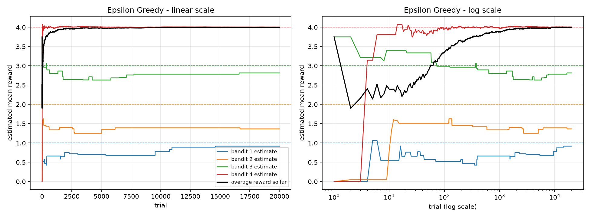
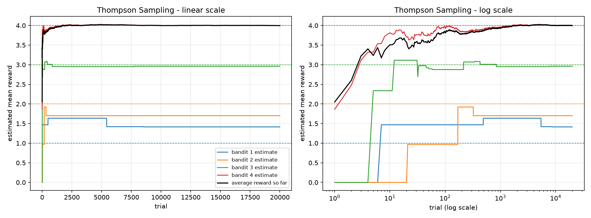
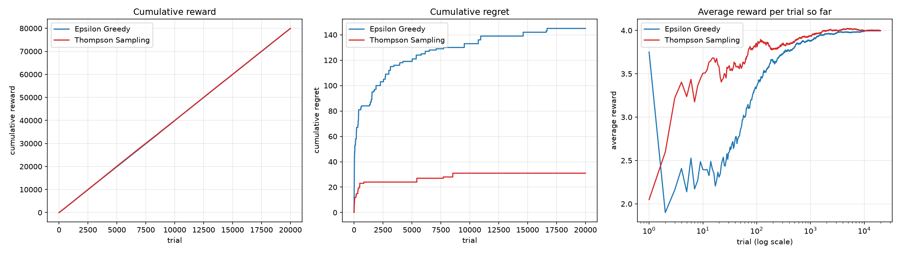
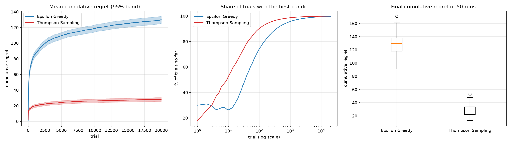

# HW2: A/B testing with Epsilon Greedy and Thompson Sampling

Marketing course, instructor Karen Hovhannisyan. Student: Stepan Titanyan.

Four ads (bandits) have the true mean rewards `Bandit_Reward = [1, 2, 3, 4]` and every algorithm gets `NumberOfTrials = 20000` trials. The goal is to design the experiment with **Epsilon Greedy** (epsilon decays by 1/t) and **Thompson Sampling** (known precision) and to compare them. The code is in `Bandit.py`.

## Files

```
HW2/
├── Bandit.py            all the code (Bandit, EpsilonGreedy, ThompsonSampling, Visualization, comparison)
├── requirements.txt     loguru==0.7.2 (from the template) + numpy, pandas, matplotlib
├── rewards.csv          the rewards of both algorithms, columns {Bandit, Reward, Algorithm}
├── README.md            this file
└── img/
    ├── plot1_epsilon_greedy.png      learning process of Epsilon Greedy (linear and log scale)
    ├── plot1_thompson_sampling.png   learning process of Thompson Sampling (linear and log scale)
    ├── plot2_cumulative_comparison.png   cumulative reward and cumulative regret of both
    └── comparison_multi_run.png      comparison() over 50 repetitions
```

## How to run

```
pip install -r requirements.txt
python Bandit.py              # experiment, csv, plots, comparison (about 1 minute)
python Bandit.py --runs 100   # more repetitions in comparison()
python Bandit.py --tune       # also the epsilon0 / prior check from the tables below (about 4 more minutes)
python Bandit.py --debug      # also show the debug messages
```

Nothing is printed with `print()`, everything uses the loguru logger (debug / info / warning / error / critical) as the template asked. The random numbers use a fixed seed (42), so the single run below can be reproduced exactly. Tested with Python 3.13 in a clean virtual environment.

## What I did

**Bandit class.** The template class is unchanged (all abstract methods are still there). I only added things: a docstring, one more abstract method `choose_arm(t)` (the policy that picks the ad) and some shared helper methods (`_setup`, `_record`, `to_frame`, ...) so that the two algorithms do not repeat the same code.

**Rewards.** Pulling bandit `k` gives a Gaussian reward with mean `Bandit_Reward[k]` and a known precision `tau = 1` (precision = 1 / variance, so the standard deviation is 1).

**Epsilon Greedy** (`EpsilonGreedy`). In trial `t` it picks a random ad with probability `epsilon_t = min(1, epsilon0 / t)` (epsilon decays by 1/t) and otherwise the ad with the highest sample mean so far. The estimates start at 0 and are updated with a running mean. I chose `epsilon0 = 10` (see below).

**Thompson Sampling with known precision** (`ThompsonSampling`, idea from Thompson, 1933; see Russo et al., 2018). The unknown mean of each ad has a Normal prior with mean `mu0 = 0` and precision `lambda0 = 0.1` (vague prior). Because the precision `tau` of the reward is known, the posterior after `n` pulls with reward sum `S` is again Normal:

```
posterior precision = lambda0 + n * tau
posterior mean      = (lambda0 * mu0 + tau * S) / posterior precision
```

Each trial it draws one sample from the posterior of every ad and pulls the ad with the highest sample.

**Regret.** The regret of a trial is `max(Bandit_Reward) - Bandit_Reward[chosen ad]` (expected regret), so the cumulative regret is 0 only if ad 4 (the best) is chosen every time. I used this and not `4 - reward`, because that one is very noisy (the reward noise is much bigger than the gaps) and can even be negative.

**Report.** `report()` of each algorithm stores the rewards in `rewards.csv` (columns `Bandit`, `Reward`, `Algorithm`, one row per trial, bandits are numbered 1 to 4 and bandit `k` has true mean `k`) and logs the cumulative reward, cumulative regret, average reward and average regret with f-strings.

**Plots.** `Visualization.plot1()` shows the learning process of each algorithm: the estimated mean of each ad after every trial (dashed lines are the true means) and the average reward so far, on a linear and a log scale. `Visualization.plot2()` compares the cumulative rewards and cumulative regrets of the two algorithms (and the average reward on a log scale as a third panel, because the two cumulative reward lines are almost on top of each other). `comparison()` repeats both algorithms many times, see below.

## Results

### One run (seed 42, what `python Bandit.py` prints first)

| | Epsilon Greedy | Thompson Sampling |
|---|---|---|
| Cumulative reward | 79,949.09 | 79,943.44 |
| Cumulative regret | 145.00 | 31.00 |
| Average reward | 3.9975 | 3.9972 |
| Average regret | 0.0073 | 0.0015 |
| Pulls of the best ad (bandit 4) | 19,929 (99.6%) | 19,980 (99.9%) |

Thompson Sampling has a much lower regret, but in this one run Epsilon Greedy has a slightly *higher cumulative reward*. That is only noise: the reward of every trial has a standard deviation of 1, so the total reward of 20,000 trials moves by about 140 just by chance, which is more than the real difference between the algorithms. This is why I compare the regret and not only the reward.





### 50 repetitions (`comparison()`)

| | Epsilon Greedy | Thompson Sampling |
|---|---|---|
| Mean cumulative reward | 79,899.27 | 79,977.80 |
| Mean cumulative regret | 129.88 | 28.06 |
| Std of cumulative regret | 16.78 | 8.95 |
| Median cumulative regret | 129.5 | 26.0 |
| Best ad chosen in | 99.67% of the trials | 99.90% of the trials |

Thompson Sampling had the lower regret in 100% of the 50 paired runs. It finds the best ad faster (middle panel: in the first 100 trials it chose ad 4 in about 90% of the trials, Epsilon Greedy in about 74%; in the first 1000 trials 98.6% against 95.7%) and it keeps almost no regret afterwards, while Epsilon Greedy keeps exploring a little (epsilon is still 10/20000 = 0.0005 at the end).



### How `epsilon0` and the prior were chosen (`python Bandit.py --tune`, 50 runs per setting)

"Stuck" means a cumulative regret above 1000, which is a lot of trials on a bad ad.

| Algorithm | Setting | Mean regret | Std | Median | % stuck |
|---|---|---|---|---|---|
| Epsilon Greedy | epsilon0 = 1 | 1894.3 | 5160.3 | 27.5 | 16.0 |
| Epsilon Greedy | epsilon0 = 2 | 617.0 | 3012.8 | 33.0 | 4.0 |
| Epsilon Greedy | epsilon0 = 5 | 79.8 | 75.1 | 67.0 | 0.0 |
| Epsilon Greedy | **epsilon0 = 10** | 123.1 | 17.6 | 120.5 | 0.0 |
| Epsilon Greedy | epsilon0 = 20 | 240.5 | 22.5 | 241.5 | 0.0 |
| Epsilon Greedy | epsilon0 = 50 | 525.6 | 32.2 | 531.0 | 0.0 |
| Epsilon Greedy | epsilon0 = 100 | 936.8 | 39.0 | 937.0 | 6.0 |
| Thompson Sampling | lambda0 = 1 | 443.2 | 693.5 | 104.0 | 14.0 |
| Thompson Sampling | **lambda0 = 0.1** | 29.8 | 9.1 | 29.0 | 0.0 |
| Thompson Sampling | lambda0 = 0.01 | 32.6 | 8.1 | 33.0 | 0.0 |

- With `epsilon_t = 1/t` (epsilon0 = 1) the algorithm explores only about ln(20000) ≈ 10 times in total. Most runs are fine (median regret 27) but in 16% of the runs it locks on a bad ad for a very long time (regret above 1000) and the mean explodes. With a very big epsilon0 the opposite happens: it explores too long (for epsilon0 = 100 the 6% "stuck" are just too much exploration). epsilon0 = 5 has the lowest mean but a large std, epsilon0 = 10 is the safest choice, so I used it. This also agrees with Auer et al. (2002), where the exploration probability decays like `c*K/(d^2*n)` and the authors say that the result depends a lot on the constant c, so it has to be tuned.
- For Thompson Sampling the prior precision matters more than I expected. With `lambda0 = 1` the prior says "the mean is around 0 plus or minus 1", but the true means are 1 to 4. An ad that was not tried yet is then very unlikely to be sampled above the ad that looks good, and in 14% of the runs the algorithm stays on a bad ad for a long time. A vague prior (`lambda0 = 0.1` or smaller) fixes this.

## Bonus: a better implementation plan

These are the things I would change to make the experiment closer to a real A/B test and the comparison more reliable.

1. **Always repeat the experiment and report an average with a confidence band** (I did this in `comparison()`). One run can be misleading: in the one run above Epsilon Greedy even has the higher reward, and with `epsilon0 = 1` the median regret is 27 but the mean is 1894 because of a few bad runs.
2. **Use the same random rewards for both algorithms** (generate a table of rewards `[trial, bandit]` once and let both algorithms read from it). Then the difference between the algorithms comes only from their decisions and not from luck, and a paired comparison needs fewer repetitions.
3. **Do not depend on a parameter that needs the unknown gap.** The good epsilon0 in Epsilon Greedy depends on the difference between the best and the second best ad (the `d` in Auer et al.), which we do not know in a real test, and the table shows that a wrong value costs a lot (mean regret is about 80 for epsilon0 = 5, but about 1900 for epsilon0 = 1 and about 940 for epsilon0 = 100). Thompson Sampling and UCB do not have this problem, so I would use one of them as default.
4. **Unknown precision.** Here the precision of the reward is known, in practice it is not. The standard fix is a Normal-Gamma prior, where the mean and the precision are learned together. If the reward is a click (0 or 1), a Beta-Bernoulli model is the natural choice.
5. **A stopping rule.** A real test should not run a fixed 20,000 trials. Stop when the posterior probability that one ad is the best is above 95% (or when the expected loss of choosing it is below a small threshold) and give the result in money or clicks.
6. **Ads change over time.** If the click rate drifts (fatigue of an ad, seasons), use a discounted or sliding-window version of the posterior so that old data counts less.
7. **Engineering.** Unit tests (the posterior update against the closed formula, the regret is never negative, the same seed gives the same result), the settings in a config file instead of constants at the top, type hints, and a GitHub Actions check that runs the tests on every push.

## Notes

- The docstrings are in reST format (the default format of `pyment`). I ran `pyment` on the file to find the functions without a docstring (it found the `choose_arm` methods and the Bandit class), then wrote the docstrings by hand, because the patch that pyment generates adds a lot of empty lines and breaks some of the inline formatting.
- The task text says "print cumulative reward / cumulative regret" and the template comments say "average", so `report()` logs both.
- The reward is simulated (Gaussian with the known means), there is no real ad data in this homework.

## References

- Auer, P., Cesa-Bianchi, N., & Fischer, P. (2002). Finite-time analysis of the multiarmed bandit problem. *Machine Learning, 47*(2-3), 235-256.
- Russo, D. J., Van Roy, B., Kazerouni, A., Osband, I., & Wen, Z. (2018). A tutorial on Thompson sampling. *Foundations and Trends in Machine Learning, 11*(1), 1-96.
- Thompson, W. R. (1933). On the likelihood that one unknown probability exceeds another in view of the evidence of two samples. *Biometrika, 25*(3-4), 285-294.
